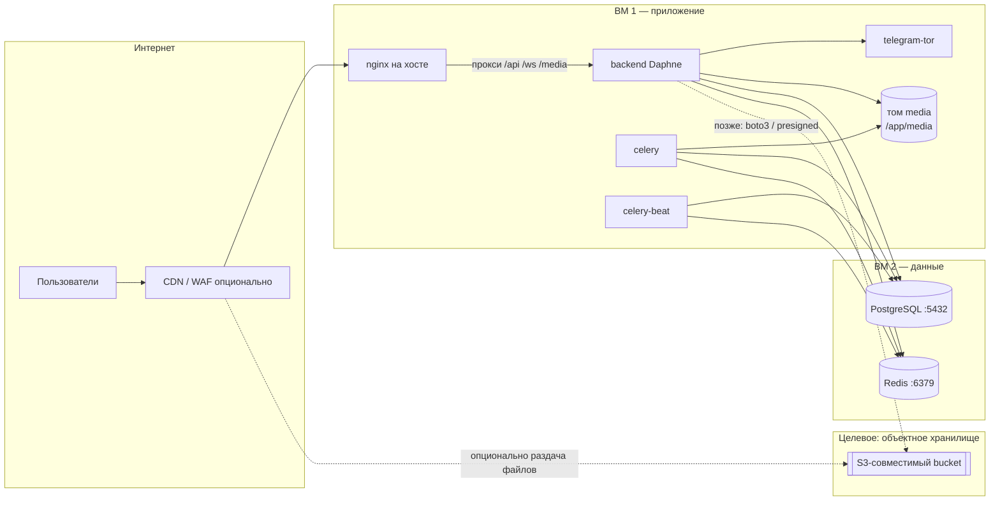

# Этап 2: две ВМ (приложение отдельно от данных)

Цель: **ВМ приложения** в «демилитаризованной» зоне (только HTTPS снаружи), **ВМ данных** в приватной сети без доступа из интернета к PostgreSQL и Redis.

Подходит для старта без Kubernetes: два сервера + приватная сеть у провайдера (или WireGuard между ВМ, если приватной сети нет).

---

## Хранилище файлов пользователей (вложения, аватары)

**Принцип:** в **PostgreSQL** хранятся только **метаданные** (кто загрузил, путь/ключ, размер, тип). **Байты файлов** — отдельно, не в БД.

Сейчас в коде PingyChat по умолчанию тип хранения **`LOCAL`**: файлы пишутся в **`MEDIA_ROOT`** на диске рядом с приложением (`config/settings/base.py`, `apps/files/`). В `docker-compose.app-node.yml` для этого выделен именованный Docker-том **`pingychat_media` → `/app/media`** у `backend` и `celery` (чтобы данные не пропадали при пересоздании контейнера). При необходимости замените том на **bind-mount** большого раздела хоста, например `/var/lib/pingychat/media:/app/media`.

**Как развивать архитектуру хранения**

| Подход | Где лежат файлы | Когда уместно |
|--------|-----------------|---------------|
| **Диск на ВМ приложения** (текущая модель) | Том Docker или отдельный volume диска ВМ 1, `MEDIA_ROOT` | Быстрый старт, небольшой объём; обязательны **бэкапы** тома и мониторинг места |
| **Объектное хранилище (S3-совместимое)** | Yandex Object Storage, AWS S3, Cloudflare R2, Backblaze B2 и т.д. | Рост трафика и объёма, несколько инстансов API, дешёвая раздача через **CDN** |
| **MinIO (или аналог) на приватной ВМ** | Отдельный сервис в сети с ВМ 1, API как у S3 | Нужен свой контроль, без публичного облачного S3 |

**Целевой контур с объектным хранилищем:** бэкенд по приватной сети загружает объект (или выдаёт клиенту **presigned URL** на прямую загрузку в bucket), в БД — только ключ и права доступа; раздача пользователю — HTTPS с bucket/CDN с подписанным URL или прокси через API. В коде для этого предусмотрен задел: комментарий про **django-storages** в `settings/base.py`.

**Nginx:** путь `/media/` как сейчас проксируется на бэкенд ([web.pingychat.com-setup.md](web.pingychat.com-setup.md)); при переходе на S3 часть вложений может отдаваться **напрямую из CDN** по URL из API.

---

## Схема сервисов



**Что где крутится**

| Узел | Сервисы | Снаружи открыто |
|------|---------|-----------------|
| **ВМ 1** | `backend`, `celery`, `celery-beat`, `telegram-tor`, том **`pingychat_media`** (файлы пользователей), на хосте — **nginx** (443 → статика + прокси на :8000) | Только **80/443** (и SSH по политике; лучше VPN/bastion) |
| **ВМ 2** | `db` (Postgres), `redis` | **Ничего из интернета**; порты 5432 и 6379 доступны **только с приватного IP ВМ 1** (firewall / security group) |
| **Облако (рекомендуется при росте)** | Bucket **S3-совместимый** + опционально CDN | Политика **private**; доступ через подписанные URL или только с бэкенда |

**Не отдельные контейнеры на этапе 2:** фронтенд — по-прежнему сборка статики (`frontend-build` или CI) в каталог nginx; балансировщик — один вход (позже добавите вторую ВМ приложения и LB).

---

## Этап A. Облако и сеть

1. Создайте **две ВМ** в одном регионе.
2. Включите **приватную сеть** (например: Hetzner Cloud Network, Yandex VPC, AWS VPC) и подключите обе ВМ к ней.
3. Запишите **приватные IP**: например ВМ1 `10.0.0.10`, ВМ2 `10.0.0.20` (подставьте свои).
4. В панели облака настройте **группу безопасности / firewall для ВМ 2**:
   - входящий **TCP 5432** — только с IP ВМ1 (или только подсеть приватной сети, если она изолирована);
   - входящий **TCP 6379** — то же правило;
   - **запрет** 5432 и 6379 из интернета (0.0.0.0/0).
5. Для **ВМ 1**: разрешите **443** (и **80** для редиректа на HTTPS) с интернета; SSH — по желанию только с вашего IP или через bastion.

---

## Этап B. ВМ 2 — данные

На **ВМ 2** (минимум 2 GB RAM, диск по объёму БД):

1. Установите Docker и Docker Compose plugin.
2. Склонируйте репозиторий (или скопируйте каталог `chat`) на сервер.
3. Создайте том PostgreSQL (один раз):

   ```bash
   docker volume create pingychat_pgdata
   ```

4. Подготовьте `postgres.docker.env` в корне проекта (как для обычного compose), с **одним и тем же** `POSTGRES_PASSWORD`, который потом укажете на ВМ 1:

   ```env
   POSTGRES_PASSWORD=длинный_случайный_пароль
   ```

5. Запустите только узел данных:

   ```bash
   cd /path/to/chat
   docker compose -f docker-compose.data-node.yml up -d
   ```

6. Проверка с **ВМ 1** (после того как на ВМ1 установлен `psql` или временный контейнер):

   ```bash
   # с ВМ 1, подставьте приватный IP ВМ 2
   nc -zv 10.0.0.20 5432
   nc -zv 10.0.0.20 6379
   ```

Если порты недоступны — сначала исправьте firewall, не ослабляйте пароли.

---

## Этап C. ВМ 1 — приложение

На **ВМ 1** (рекомендуется **4 GB RAM**, 2 vCPU):

1. Docker + Docker Compose.
2. Тот же код репозитория, полный `backend/.env` (секреты, `SECRET_KEY`, токены и т.д.) — как для продакшена.
3. Создайте `app-node.docker.env` из примера:

   ```bash
   cp deploy.stage2.env.example app-node.docker.env
   ```

   Отредактируйте:

   - `DATA_NODE_HOST` — **приватный IP ВМ 2**;
   - `POSTGRES_PASSWORD` — **тот же**, что в `postgres.docker.env` на ВМ 2.

4. Примените миграции **один раз** к БД на ВМ 2 (удобно запустить отсюда же):

   ```bash
   cd /path/to/chat
   docker compose -f docker-compose.app-node.yml --env-file app-node.docker.env run --rm backend python manage.py migrate
   ```

5. Поднимите стек приложения:

   ```bash
   docker compose -f docker-compose.app-node.yml --env-file app-node.docker.env up -d
   ```

   Флаг `--env-file` нужен, чтобы подставились `DATA_NODE_HOST` и `POSTGRES_PASSWORD` в `DATABASE_URL` / `REDIS_URL` внутри compose.

6. Nginx на **хосте** ВМ 1: проксируйте `https://ваш-домен` на `http://127.0.0.1:8000`, настройте TLS (Let’s Encrypt). Статику фронта отдавайте из `/var/www/...` или того пути, который используете в проде. Убедитесь, что есть `location /media/` → бэкенд (см. [web.pingychat.com-setup.md](web.pingychat.com-setup.md)).

7. **Место под файлы:** по умолчанию данные в Docker-томе `pingychat_media`. Для больших объёмов смонтируйте в `docker-compose.app-node.yml` вместо тома каталог хоста, например `- /var/lib/pingychat/media:/app/media`, и при необходимости задайте в `backend/.env` явно `MEDIA_ROOT=/app/media`.

---

## Этап D. Фронтенд

Как и при одном сервере: сборка и копирование статики (пример из основного `docker-compose.yml`):

```bash
docker compose -f docker-compose.yml --profile frontend run --rm frontend-build
```

На двух ВМ проще собирать фронт в CI или локально и копировать на ВМ1 в каталог nginx.

---

## Этап E. Обновления и бэкапы

- **Код бэкенда:** `git pull` на ВМ1 → `docker compose -f docker-compose.app-node.yml --env-file app-node.docker.env build --no-cache` → `up -d`.
- **Бэкап PostgreSQL:** с ВМ2 или с ВМ1 по приватной сети, например `pg_dump` по расписанию (cron); хранить шифрованные дампы **в другом** хранилище/аккаунте.
- **Бэкап файлов пользователей:** том `pingychat_media` или каталог bind-mount — копировать **вместе с** политикой восстановления (rsync/restic/снимки диска). После перехода на S3 — версионирование bucket и отдельная политика lifecycle.

---

## Вариант: managed PostgreSQL вместо ВМ 2

Если берёте **managed Postgres** у облака:

- Отдельная **ВМ 1** с `docker-compose.app-node.yml` остаётся.
- **Redis** можно оставить на ВМ1 в маленьком контейнере или взять managed Redis.
- В `app-node.docker.env` укажите в `DATA_NODE_HOST` хост выдачи провайдера (или отдельно перепишите `DATABASE_URL` в override-файле — тогда нужен небольшой кастомный фрагмент compose).

---

## VPN вместо Tor для Telegram

Скопируйте паттерн из `docker-compose.telegram-gluetun.yml`: в `docker-compose.app-node.yml` замените сервис `telegram-tor` на `telegram-vpn` (Gluetun), обновите у `backend` переменную `TELEGRAM_GATEWAY_HTTPS_PROXY` и блок `depends_on`, как в том файле.

---

## Файлы в репозитории

| Файл | Назначение |
|------|------------|
| `docker-compose.data-node.yml` | Только Postgres + Redis для **ВМ 2** |
| `docker-compose.app-node.yml` | Backend + Celery + Beat + Tor для **ВМ 1** |
| `deploy.stage2.env.example` | Шаблон `app-node.docker.env` |
| `docs/deploy-stage2-two-vm.md` | Эта инструкция |

Локальная разработка и односерверный прод по-прежнему через корневой `docker-compose.yml`.
